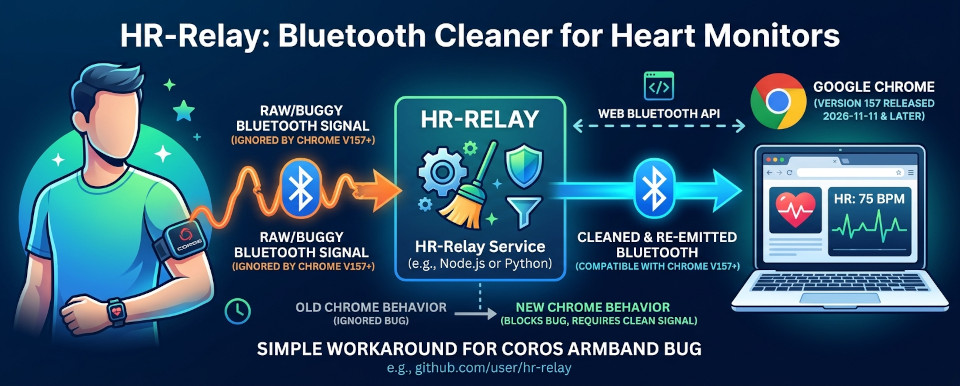

# hr-relay


I have an heart monitoring armband by COROS, that use via a simple html connecting to it via Google Chrome bluetooth BLE layer. But the armband had a bug that was ignored by Google Chrome up to now, but is not blocking with its version 157 released in 2026-11-11. Hr-relay is a simple workaround for this: it connects to the armband, ignoring the bug like the old Google Chrome, and re-emit it as a cleaned Bluetooh protocol that the new Chrome can use as it if was a proper armband. This can help other heart monitoring devices that may have a similar bug, and other browsers based on Chrome: Edge, Opera, Vivaldi, Samsung...

A tiny BLE heart-rate relay in Go. It connects to a Bluetooth heart-rate
monitor (chest strap, armband, watch) over a clean BlueZ stack and
**re-advertises itself as a plain, standard heart-rate belt**, forwarding every
measurement to whatever connects to it — typically a phone browser over Web
Bluetooth.

It exists because many cheap and mid-range heart-rate monitors are not clean
BLE peripherals: they stream proprietary telemetry on vendor characteristics
alongside the standard heart-rate data. Some phone Bluetooth stacks (notably
recent Chrome/Chromium on Android) choke on that extra traffic and never finish
subscribing. The relay sits in the middle and presents a single, textbook
`0x2A37` heart-rate characteristic — nothing else — so the buggy client only
ever sees a well-behaved device.

**This is not tied to any one app or any one strap.** Use it with any Web
Bluetooth web app (fitness apps, web players, dashboards) and any heart-rate
monitor that misbehaves when a phone connects to it directly.

## When you need it

Reach for the relay when a heart-rate monitor works fine with a dedicated app
or on a laptop, but a phone browser can connect and then hangs — usually
`startNotifications()` never resolves, or the heart rate never appears. Common
on budget straps that advertise vendor services (Nordic UART, "FitCast", etc.)
next to the standard Heart Rate service. If your strap already works in the
browser, you don't need this.

## How it works

```
[ HR strap ]  --BLE-->  hr-relay (Linux + BlueZ)  --BLE-->  phone browser
   (vendor noise)         cleans it up to a single            (sees a plain
                           standard 0x2A37 char               HR belt)
```

The relay is a BLE **central** to the strap and a BLE **peripheral** to the
phone. It forwards the raw Heart Rate Measurement bytes verbatim, so the data
is byte-for-byte the strap's own — zones, cadence, everything downstream works
unchanged.

## Build

Requires Go and a machine with a Bluetooth adapter (built and tested with BlueZ
5.85). Any Linux box with BLE works — a server, a Raspberry Pi, a laptop.

    go build -o hr-relay .

## Usage

Start it (it advertises as **HR RELAY** by default), then in your web app pick
**HR RELAY** in the Bluetooth device chooser instead of the raw strap. The real
strap is usually not listed while the relay holds its link — that is expected.

1. Pick **HR RELAY** → the app subscribes and shows `--` (no heart rate yet).
2. Put the strap on and wear it. The relay's link comes up, it starts
   forwarding, and the heart rate appears live with no further action.

The `--` in step 1 is correct, not a failure: the relay forwards only real
measurements, so there is nothing to show until the strap is worn. It
reconnects to the strap automatically whenever it wakes up.

### Example: walkpadspeed

In [walkpadspeed](https://github.com/ColasNahaboo/walkpadspeed), tap the ❤ HR
box and pick **HR RELAY**. This is the setup the relay was first built and
validated for (see below), but any Web Bluetooth heart-rate consumer works the
same way.

## Flags

| flag | default | meaning |
|---|---|---|
| `-addr` | `D1:F9:A6:A2:FC:6D` | sensor address; empty to match by name prefix |
| `-name` | `COROS HEART RATE` | sensor advertised-name prefix (used when `-addr` is empty) |
| `-advertise-name` | `HR RELAY` | name shown in the phone's device chooser |
| `-retry-secs` | `5` | seconds between sensor reconnect attempts |
| `-stale-secs` | `60` | drop the sensor link after this long without data (0 disables) |
| `-debug` | off | log every raw heart-rate notification |

Point it at your own strap with `-addr` (its MAC, from `bluetoothctl scan on`)
or `-name` (its advertised-name prefix). The defaults are the COROS strap this
was developed against.

## Service

Runs as a systemd user service (**disabled by default** — see "Coexistence"
below for why):

    systemctl --user start hr-relay     # enable and hold the strap
    systemctl --user disable --now hr-relay  # stand down again
    journalctl --user -u hr-relay -f
    systemctl --user restart hr-relay   # after code changes, or if advertising stalls

## Why it fixes the buggy-device case

Some straps stream notifications on vendor-service characteristics the phone
has no wrapper for. In affected Chromium builds each unexpected notification
throws inside the GATT layer and stalls the per-device queue, so the standard
characteristic's subscription write (the CCCD write) is never acknowledged and
`startNotifications()` hangs forever — even though the strap is perfectly
healthy and answers other stacks instantly.

The relay presents a single standard `0x2A37` characteristic and nothing else,
so the broken dispatch path is never exercised. Validated end-to-end on the
affected Chrome 157 build (2026-11-15): the phone's `startNotifications`
completes (`onDescriptorWrite status:0`) and live heart rate flows once the
strap is worn — the first method that worked reliably where direct connection,
Vivaldi and Edge all failed. A full trace of the underlying Chrome regression is
in
[walkpadspeed/docs/bugreport-google-chrome-v157.md](https://github.com/ColasNahaboo/walkpadspeed/blob/main/docs/bugreport-google-chrome-v157.md).

## Coexistence

The strap streams to exactly **one central at a time**: when the phone's
browser connects to the strap directly and subscribes, the strap stops
notifying the relay (and vice versa). With the relay running, its staleness
watchdog then drops and re-subscribes every ~60 s, which would rip the stream
away from a direct connection mid-workout. So run **either** the relay **or** a
direct app-to-strap connection, never both. That is why the service ships
disabled; start it only when the direct path is broken.
